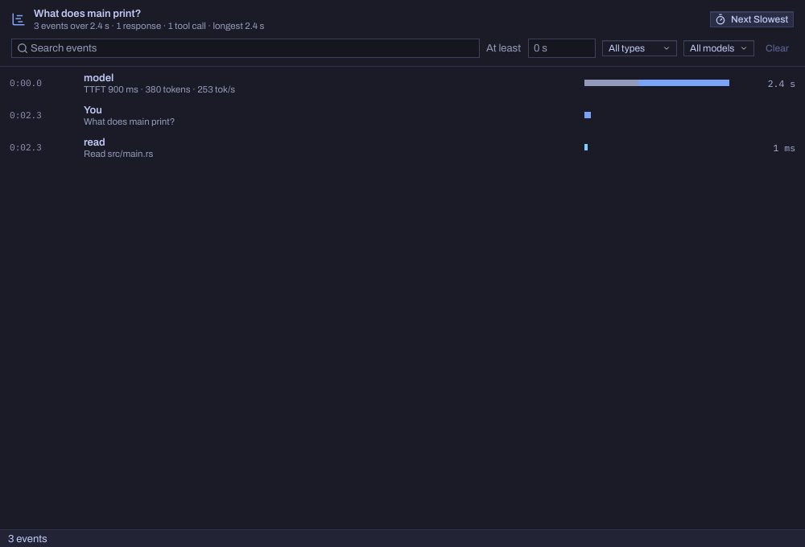
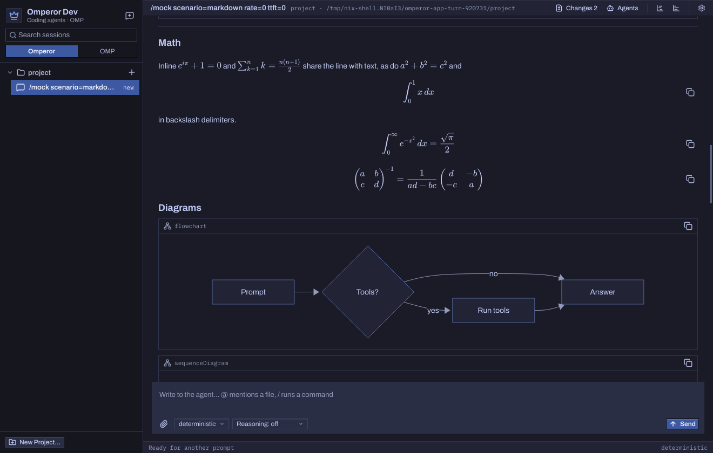
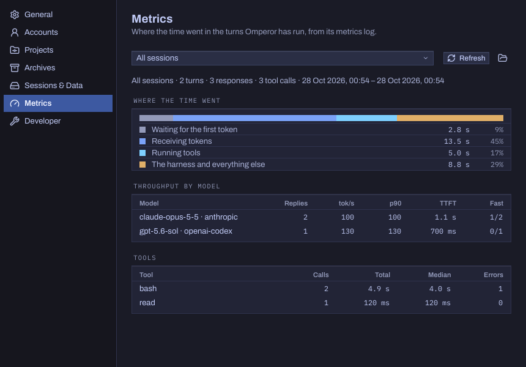

# Omperor

Omperor is a desktop app for working with coding agents. You give an agent a
project folder and a task. Omperor shows its reasoning, every tool call it
makes, the sub-agents it delegates to, and the changes it leaves in your
working tree, as they happen.

<picture>
  <source media="(prefers-color-scheme: dark)" srcset="docs/screenshots/main-dark.png">
  
</picture>

It is a native app for [Aizome](https://github.com/bitemyapp/sekka/tree/main/desktop/aizome),
the Wayland desktop of [Sekka](https://github.com/bitemyapp/sekka), written
in Rust with Aizome's toolkit, `aizome-kit`: no web view, no Electron. It
takes its type, colours, menus and keyboard from the desktop, follows Night
and Day with it, and puts its commands in the shell's menu bar, where Help ▸
Search finds them.

The agent itself is [oh-my-pi](https://github.com/can1357/oh-my-pi) (OMP).
Omperor builds OMP from source with its own patches, runs it as a child
process, and talks to it over OMP's typed RPC. OMP handles provider sign-in,
model protocols, tools and session journals. Omperor is the interface around
it.

## Status

Experimental. There are no binary releases; you build it yourself. It runs on
x86-64 Linux under Aizome, and under other Wayland compositors with Aizome's
fonts installed.

## What it does

- **Projects and sessions.** A project groups one or more folders, and each
  holds its sessions. Sessions persist and resume after a restart, and several
  can run at once; a draft not yet sent comes back too. You can fork a
  session, or fork it into a new git branch and worktree. A project can be
  archived to a compressed file and restored later.
- **Accounts.** Sign in with a ChatGPT or Claude subscription, an OpenAI or
  Anthropic API key, or a ChatGPT access token. Several accounts per provider
  are supported, and the choice is explicit: accounts carry labels, each
  provider has a default, a project remembers its choice, and the app asks
  when nothing decides. Account cards show the plan and usage limits the
  provider reports.
- **Models and reasoning.** The model list comes from the providers through
  OMP's discovery, not from a list compiled into the app. The composer has
  model, reasoning-effort and account pickers, and a Fast switch for OpenAI
  models that offer a priority tier.
- **The composer.** `@` brings a project file into the prompt, `/` runs a
  command (`/usage`, `/omperor`), ↑ recalls earlier prompts, and Esc stops a
  turn. Writing while the agent works steers the turn under way.
- **Attachments.** Paste images, drop files, or use the paperclip. Images up
  to 8 MiB are sent as images and UTF-8 text up to 128 KiB as quoted text.
  Other files are passed as paths the agent's tools can read.
- **Agent activity.** The conversation shows reasoning and every tool call,
  folded to a line each and opened with a click; a failed call stands out.
  The Agents panel lists a session's sub-agents while they run, with what
  each has done, and quotes one into your draft to discuss it.
- **Changes.** The Changes panel shows the project's uncommitted work as a
  file tree and highlighted diffs, and opens a file in your editor or a
  terminal in its folder.
- **Rendering.** Answers are Markdown, drawn by the app: headings, lists,
  tables, quotes and callouts, and code highlighted in the theme's colours.
  Pictures show from files (a relative path is read from the session's
  folder), from `data:` URLs, and from the web when Settings allows it or
  you ask for one; SVGs stay sharp at any size, and a click opens a
  picture in its viewer. Math (between `$`s, `$$`s, `\(…\)` or `\[…\]`)
  is set as KaTeX sets it, in its lines or on its own, and copying a
  formula gives back its LaTeX. Mermaid diagrams are laid out as Mermaid
  lays them out and drawn in the desktop's type and colours.
- **Looking back.** A session's Timeline puts every prompt, response and tool
  call on one clock with how long each took, filtered by kind, model, a
  minimum duration or a search. Its Usage window breaks the tokens into
  input, output and cache, per request and with sub-agents included, and the
  status line counts down to the provider's prompt cache expiring. Settings ▸
  Metrics shows where the time went across turns.
- **Headless evals.** `omperor eval` runs task suites against real inference,
  with the same helper and accounts, without opening a window.

<p align="center">
  
  
</p>
<p align="center">
  
  
</p>

The screenshots come from `just shots`, which drives the app headless with
its built-in mock backend and a small demo project, so no account or
inference is involved; the model names in them are stand-ins.

## Requirements

- x86-64 Linux with Wayland. The OMP helper embeds a Python build, and its
  build script fetches one for x86-64 Linux only.
- [Nix](https://nixos.org/download) with flakes. `nix develop` gives the
  toolchain `rust-toolchain.toml` pins, `just`, the linker setup, the native
  libraries the helper links, and Aizome's fonts.
- Network access for the first build. Cargo downloads crates, and the helper
  build downloads a
  [python-build-standalone](https://github.com/astral-sh/python-build-standalone)
  archive from GitHub and one package from PyPI.

## Build and run

Clone the repository with its submodules:

```sh
git clone --recurse-submodules https://github.com/bitemyapp/omperor.git
cd omperor
nix develop
```

In an existing clone, fetch them with `git submodule update --init --recursive`.

| Command | What it does |
|---|---|
| `just run` | Builds and runs Omperor Dev, optimized. |
| `just run-debug` | The same, as a debug build. |
| `just install` | Builds Omperor and installs it, its helper, its desktop entry and its icon under `~/.local` (`PREFIX=… just install` for elsewhere). It does not stop a running copy. |
| `just uninstall` | Removes what `just install` installed; your state stays. |
| `just test` | Runs the tests, the window driven headless among them. |
| `just shots` | Redraws the screenshots above. |
| `just helper` | Builds only the OMP helper. |
| `just` | Lists every recipe. |

The first build compiles OMP with Omperor's patches applied, which takes
half an hour or so. Later builds reuse the helper until the submodule, the
patches, the toolchain or the build script changes.

Local builds are named **Omperor Dev** (`org.aizome.OmperorDev`) and keep
their state apart from the installed **Omperor** (`org.aizome.Omperor`), so
both can run at once. A second launch hands its folders to the one running:
`omperor ~/src/thing` opens that folder as a project.

## First launch

1. Open Settings (❖,), choose **Accounts**, and sign in. ChatGPT and Claude
   subscriptions sign in through the browser; API keys and ChatGPT access
   tokens are pasted.
2. Choose **New Project…** in the sidebar (⇧❖N) and pick the folder the agent
   should work in. Until you do, the app opens the checkout it was built from
   (`OMPEROR_PROJECT` overrides this; if neither exists, your home folder).
3. Pick a model, reasoning level and account in the composer, and send a
   prompt.

Agents run shell commands and edit files in the project folder with your
permissions. Read [SECURITY.md](SECURITY.md) before pointing Omperor at
anything you care about.

## Where state lives

| Edition | State root |
|---|---|
| Omperor (`just install`) | `$XDG_DATA_HOME/omperor` |
| Omperor Dev (local builds) | `$XDG_DATA_HOME/omperor-dev` |

`$XDG_DATA_HOME` defaults to `~/.local/share`.

Each root holds Omperor's database (`omperor.sqlite3`), OMP's session
journals and metrics (`omp/sessions`), OMP's credentials and caches
(`omp/data`), project archives, and worktrees. Settings ▸ Sessions & Data
shows the folders. Set `OMPEROR_STATE_DIR` to an absolute path to use a
different root. See [docs/STATE_ISOLATION.md](docs/STATE_ISOLATION.md).

## Evals

```sh
just helper
cargo build --release
./target/release/omperor eval doctor       # is this machine ready?
./target/release/omperor eval suite --output /tmp/evals/first --tag smoke
```

[docs/EVALS.md](docs/EVALS.md) covers headless sign-in, suites, writing
tasks, and how to read the results.

## Repository layout

| Path | Contents |
|---|---|
| `src/app/` | The program: its state, the messages that change it, and the work it sends to workers. |
| `src/ui/` | The windows, drawn from that state with Aizome's widgets. |
| `src/markdown/` | Markdown read into a document, highlighted, and drawn. |
| `src/` | The rest: the OMP runtime client, sessions and journals, projects and archives, accounts and usage, the eval runner. |
| `data/` | The desktop entry and the app icon. |
| `scripts/` | The OMP helper's build, and an RPC isolation check. |
| `patches/oh-my-pi/` | Omperor's fixes to OMP, applied when the helper is built. |
| `vendor/oh-my-pi/` | OMP, the agent runtime (submodule). |
| `vendor/sekka/` | Sekka, for Aizome's toolkit and Sidestep beneath it (submodule). |
| `evals/` | Eval tasks, graders and JSON schemas. |
| `tests/readme-demo/` | The small project the screenshots work on. |
| `docs/` | Design notes, references, and the screenshots. |

[CONTRIBUTING.md](CONTRIBUTING.md) explains how to work on the code.

## License

Omperor's own code, documentation and assets are licensed under either the
[MIT license](LICENSE-MIT) or the [Apache License 2.0](LICENSE-APACHE), at
your option. See [LICENSE](LICENSE).

The submodules and dependencies keep their own licenses. See
[docs/LICENSING.md](docs/LICENSING.md) for third-party notices and the
dependency boundaries.
