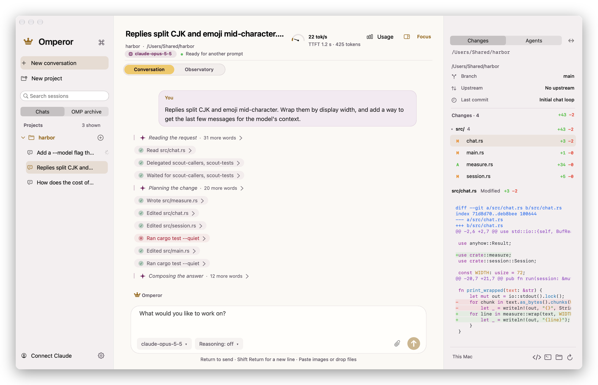
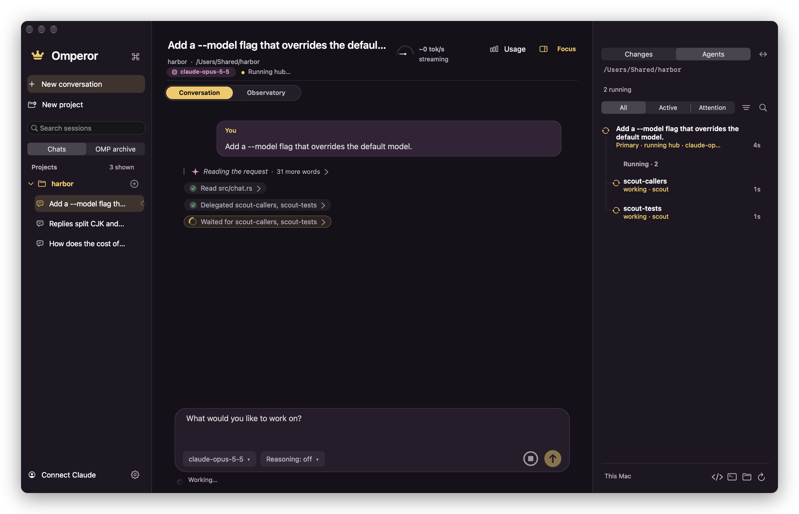
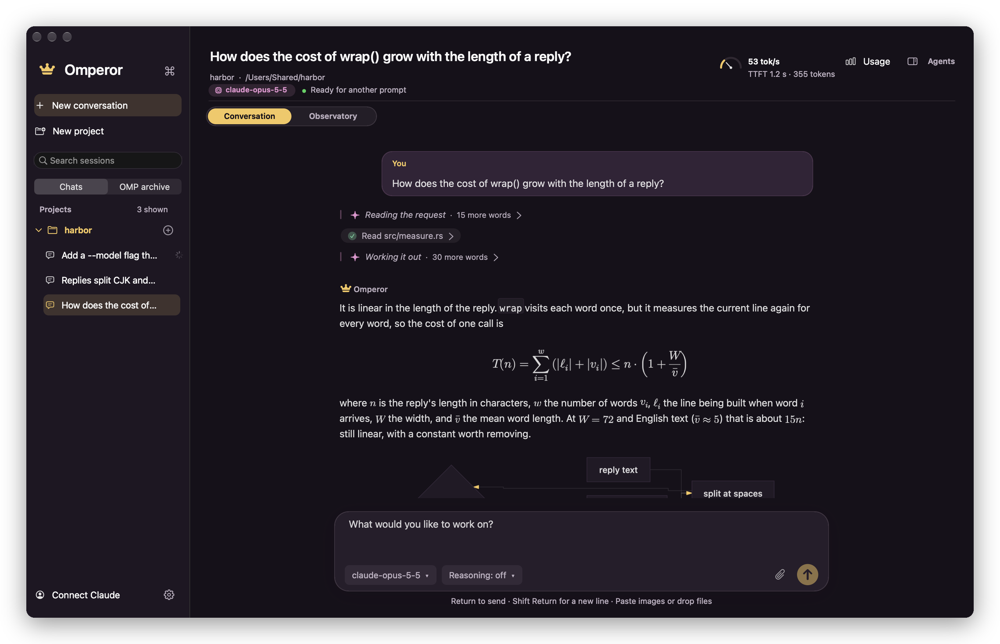

# Omperor

Omperor is a native desktop app for working with coding agents. You give an
agent a project folder and a task. Omperor shows its reasoning, every tool
call it makes, the sub-agents it delegates to, and the changes it leaves in
your working tree, as they happen.

<picture>
  <source media="(prefers-color-scheme: dark)" srcset="docs/screenshots/main-dark.png">
  
</picture>

It is written in Rust directly against AppKit through
[objc2](https://github.com/madsmtm/objc2): no web view, no Electron, no Swift.
The window is made of real AppKit views, so it scrolls, selects text, and
follows the system's appearance the way a Mac app should.

The agent itself is [oh-my-pi](https://github.com/can1357/oh-my-pi) (OMP).
Omperor builds OMP from source with its own patches, runs it as a child
process, and talks to it over OMP's typed RPC. OMP handles provider sign-in,
model protocols, tools and session journals. Omperor is the interface around
it.

## Status

Experimental. There are no binary releases; you build it yourself.

- **macOS** is the primary platform: macOS 13 or later on Apple silicon.
- **Linux** runs the same AppKit code through
  [Sidestep](https://github.com/bitemyapp/sidestep), an Objective-C runtime and
  AppKit written in Rust. It is experimental; see
  [Linux and Sidestep](#linux-and-sidestep).

## What it does

- **Projects and sessions.** A project groups one or more folders, and each
  holds its sessions. Sessions persist and resume after a restart, and several
  can run at once. You can fork a session, or fork it into a new git branch and
  worktree. A project can be archived to a compressed file and restored later.
- **Accounts.** Sign in with a ChatGPT or Claude subscription, an OpenAI or
  Anthropic API key, or a ChatGPT access token. Several accounts per provider
  are supported, and the choice is explicit: accounts carry labels, each
  provider has a default, a project remembers its choice, and the app asks
  when nothing decides. Account cards show the plan and usage limits the
  provider reports.
- **Models and reasoning.** The model list comes from the providers through
  OMP's discovery, not from a list compiled into the app. The composer has
  model, reasoning-effort and account pickers, and a Fast switch for OpenAI
  models that offer a priority tier.
- **Attachments.** Paste images, drop files, or use the paperclip button.
  Images up to 8 MiB are sent as images and UTF-8 text up to 128 KiB as quoted
  text. Other files are passed as paths the agent's tools can read.
- **Agent activity.** The transcript shows reasoning summaries and every tool
  call with its result, and a failed call stands out from the ones that
  worked. The Agents panel lists the sub-agents a session starts, while they
  run. The Observatory reads their recorded transcripts beside the
  conversation.
- **Changes.** The Changes panel shows the project's uncommitted work as a
  file tree and syntax-highlighted diffs, and opens a file in your editor or a
  terminal in its folder.
- **Rendering.** Answers are laid out natively by
  [Upleft](https://github.com/bitemyapp/upleft), a Rust port of the Downright
  Markdown renderer: tables, highlighted code, callouts, math and Mermaid
  diagrams. Copying a formula gives back its LaTeX.
- **Token usage and prompt caches.** The Usage window breaks a session's
  tokens into input, output and cache reads, per request and with sub-agents
  included. The composer counts down to the expected expiry of the provider's
  prompt cache.
- **Headless evals.** `omperor eval` runs task suites against real inference,
  with the same helper and accounts, without opening a window.

<p align="center">
  
  
</p>
<p align="center"><sub>Left: a session delegating to two sub-agents, shown in the Agents panel while they work. Right: an answer with display math, a Mermaid flowchart and a table, laid out natively.</sub></p>

The screenshots come from `just readme-shots`, which runs the app headless
against its built-in mock backend and a small demo project, so no account or
inference is involved; the model names in them are stand-ins.

## Requirements

- An Apple silicon Mac with macOS 13 or later. The OMP helper embeds a Python
  build, and the build scripts fetch it only for arm64 macOS and x86-64
  Linux.
- Xcode Command Line Tools with an SDK that LLD 22 can read. The macOS 27 SDK
  uses `arm64e.x1` stubs that LLD 22 cannot parse. The `justfile` and
  `scripts/build-omp-helper.sh` pick the newest SDK without them, so keep a
  macOS 26 or older SDK installed beside a newer one, or set `SDKROOT`.
- [rustup](https://rustup.rs). `rust-toolchain.toml` pins
  `nightly-2026-08-08`, and rustup installs it on first use.
- Homebrew packages:

  ```sh
  brew install just lld lld@22 zstd uv opus pkgconf
  ```

  | Package | Why |
  |---|---|
  | `just` | Runs the recipes below, here and in OMP. |
  | `lld@22` | Links the embedded Python, which is LLVM 22 bitcode. |
  | `lld` | Provides `/opt/homebrew/bin/ld64.lld`, the linker OMP's Cargo configuration names. |
  | `zstd`, `uv` | Unpack the Python archive and install its one bundled package. |
  | `opus`, `pkgconf` | OMP links libopus. Without a pkg-config-visible copy, the build compiles it with CMake and Ninja instead. |

- Network access for the first build. Cargo downloads crates, and the helper
  build downloads a
  [python-build-standalone](https://github.com/astral-sh/python-build-standalone)
  archive from GitHub and one package from PyPI.

## Build and run

Clone the repository with its submodules:

```sh
git clone --recurse-submodules https://github.com/bitemyapp/omperor.git
```

In an existing clone, fetch them with `git submodule update --init --recursive`.

| Command | What it does |
|---|---|
| `just run` | Builds the optimized app and opens it. |
| `just release` | Builds `target/Omperor Dev.app` without opening it. |
| `just install` | Builds the production app and copies it to `/Applications/Omperor.app`, using `sudo` if that folder is not writable. It does not stop a running copy. |
| `just debug` | Builds a debug bundle, for use under a debugger. |
| `just test` | Runs `cargo test`, generating the Markdown renderer's test corpus first if needed. |
| `just readme-shots` | Regenerates the screenshots above, headless. |
| `just` | Lists every recipe. |

The first build compiles OMP with Omperor's patches applied, which takes
several minutes. Later builds reuse the helper until the submodule, the
patches, the toolchain, the linker or the SDK changes.

Local builds are named **Omperor Dev** and keep their state apart from the
installed **Omperor**, so both can run at once.

## First launch

1. Open Settings (⌘,), choose **Accounts**, and sign in. ChatGPT and Claude
   subscriptions sign in through the browser; API keys and ChatGPT access
   tokens are pasted.
2. Choose **New project** in the sidebar and pick the folder the agent should
   work in. Until you do, the app opens the checkout it was built from
   (`OMPEROR_PROJECT` overrides this; if neither exists, your home folder).
3. Pick a model, reasoning level and account in the composer, and send a
   prompt.

Agents run shell commands and edit files in the project folder with your
permissions. Read [SECURITY.md](SECURITY.md) before pointing Omperor at
anything you care about.

## Where state lives

| Edition | State root |
|---|---|
| Omperor (`just install`) | `~/Library/Application Support/Omperor` |
| Omperor Dev (local builds) | `~/Library/Application Support/Omperor Dev` |

Each root holds Omperor's database (`omperor.sqlite3`), OMP's session
journals and metrics (`omp/sessions`), OMP's credentials and caches
(`omp/data`), project archives, and worktrees. Set `OMPEROR_STATE_DIR` to an
absolute path to use a different root. See
[docs/STATE_ISOLATION.md](docs/STATE_ISOLATION.md).

## Evals

```sh
just release                               # builds target/Omperor Dev.app and its helper
./target/release/omperor eval doctor       # is this machine ready?
./target/release/omperor eval suite --output /tmp/evals/first --tag smoke
```

[docs/EVALS.md](docs/EVALS.md) covers headless sign-in, suites, writing
tasks, and how to read the results.

## Linux and Sidestep

Omperor has no separate Linux interface. The same AppKit code that runs on
the Mac builds for Linux against
[Sidestep](https://github.com/bitemyapp/sidestep).

Sidestep provides what objc2 expects to find on a Mac:

- an Objective-C runtime, written in Rust;
- Foundation and AppKit classes, written in Rust with objc2's own
  `define_class!`, drawn and composited by Sidestep itself on Wayland.

objc2 and its framework crates are used unmodified, apart from a few fixes
Sidestep applies at build time until upstream releases them. On macOS, none of
this is in the build: the app links Apple's frameworks as usual.

Building for Linux:

```sh
git submodule update --init --recursive
just linux          # or: scripts/linux-cargo build --release --locked
just test-linux     # the Linux build's tests
```

The executable is `target/release/omperor`. It looks for the OMP helper at
`target/omperor-helpers/omp`, or wherever `OMPEROR_OMP_EXECUTABLE` points.

`scripts/linux-cargo` needs Python 3, Git and `flock`. It builds Sidestep's
fixed objc2 crates into the ignored `.objc2-overlay/` directory, and stages
Omperor, Upleft and Sidestep there. `Cargo.linux.lock` records the Linux
dependencies separately, so the macOS build keeps using the published objc2
crates.

Linux-only differences live in small patches applied to the staged copies,
never to the submodules. `patches/upleft/` covers atomic file operations,
theme watching with inotify, ICU sentence boundaries in place of Apple's
tokenizer, and Mermaid's number parsing. `patches/sidestep/` covers text
fields, transparent popups, symbol font fallback, animation, and scrolling.

What to expect:

- **Wayland only.** Sidestep does not support X11 yet. The app needs a Wayland
  session and system fonts through fontconfig.
- **The whole interface builds.** The composer, the transcript with Upleft's
  rendering, scrolling and animated transitions have been exercised on Linux.
  Diagnostics check typing and submitting, scrolling under real input timing,
  and the Conversation/Observatory switch.
- **AppKit is not complete.** A successful build does not guarantee that every
  AppKit behaviour matches macOS. A class Sidestep has not implemented yet
  stops the app the first time it is used.

[docs/LINUX_BUILD.md](docs/LINUX_BUILD.md) has the details and the Linux
diagnostics. Sidestep's [README](https://github.com/bitemyapp/sidestep#readme)
and roadmap describe the runtime itself and how to use it for other objc2
apps.

## Repository layout

| Path | Contents |
|---|---|
| `src/` | The app: AppKit interface, OMP runtime client, eval runner. |
| `macos/` | `Info.plist` and the app icon. |
| `scripts/` | Build, run and test scripts behind the `justfile`. |
| `patches/oh-my-pi/` | Omperor's fixes to OMP, applied when the helper is built. |
| `patches/upleft/`, `patches/sidestep/` | Patches applied only to the Linux build. |
| `vendor/oh-my-pi/` | OMP, the agent runtime (submodule). |
| `vendor/upleft/` | The Markdown renderer (submodule). |
| `vendor/sidestep/` | The Objective-C runtime and AppKit for Linux (submodule). |
| `evals/` | Eval tasks, graders and JSON schemas. |
| `tests/` | Linux test harnesses, Markdown fixtures, the screenshot demo project, recorded performance data. |
| `docs/` | Design notes, references, and the README's screenshots. |

[CONTRIBUTING.md](CONTRIBUTING.md) explains how to work on the code.

## License

Omperor's own code, documentation and assets are licensed under either the
[MIT license](LICENSE-MIT) or the [Apache License 2.0](LICENSE-APACHE), at
your option. See [LICENSE](LICENSE).

The submodules and dependencies keep their own licenses. In particular,
Upleft's ELK layout crate is EPL-2.0, and the bundled math fonts are under
the SIL Open Font, STIX and GUST font licenses. See
[docs/LICENSING.md](docs/LICENSING.md) for third-party notices and the
dependency boundaries.
