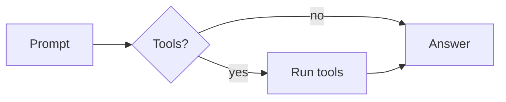
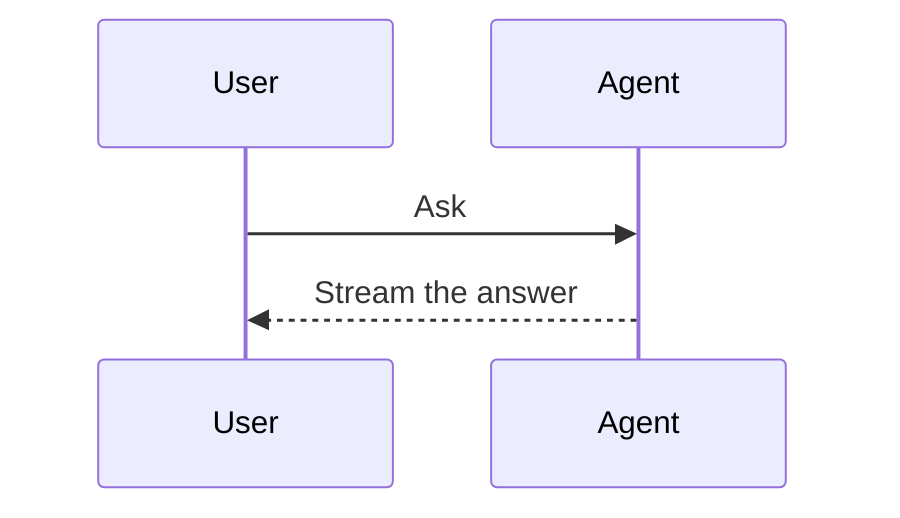
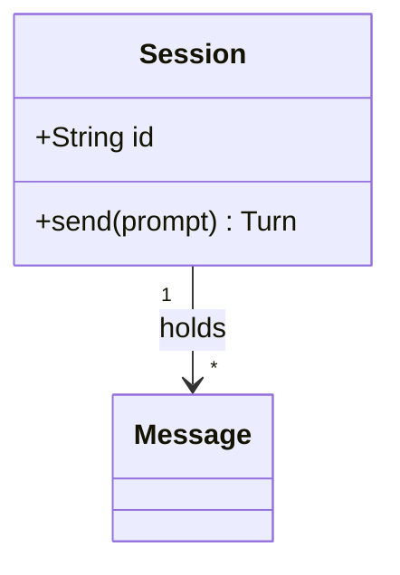
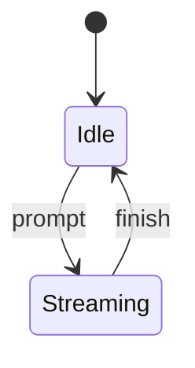
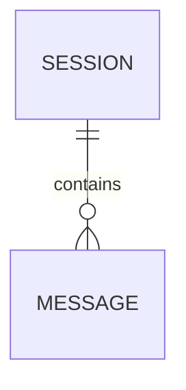
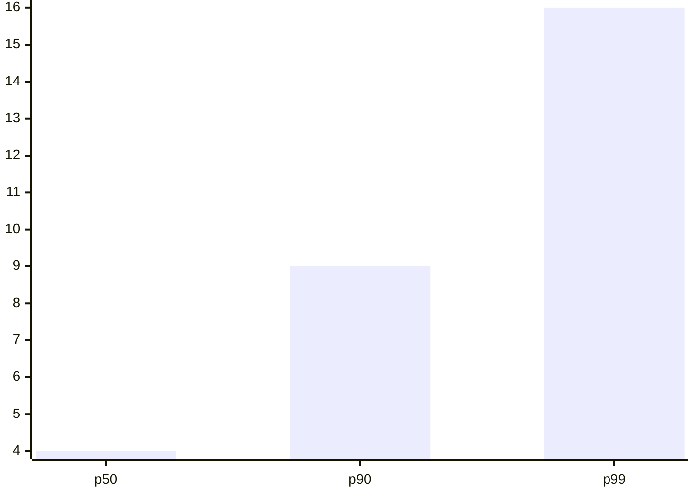

# Markdown stress test

One answer that touches every construct the transcript draws. Inline: **bold**, *italic*, ***both***, ~~struck~~, `inline code`, a [titled link](https://example.com/docs "Documentation"), an autolink <https://example.com>, a bare https://example.com/bare URL, a footnote[^timing], a wikilink [[Design notes]], paths src/main.rs:42 and `docs/README.md`, emoji 🚀 and **✅ bold emoji**, keys <kbd>⌘</kbd>+<kbd>K</kbd>, and a hard break here\
that continues on the next line. Café, naïve, Ελληνικά, 日本語, العربية, and a composed é.

## Lists

- An unordered item long enough to wrap past the measure, so the hanging indent under its marker is visible.
  - A nested item
    - A third level with `code`
- [x] A finished task
- [ ] An open task

3. An ordered list starting at three
4. A loose item with a second paragraph:

   The paragraph stays inside the item.
5. The last item

## Quotes and callouts

> A quotation with *emphasis*.
>
> > And a nested one.

### Callouts

> [!NOTE]
> A callout has an icon and a tint.

> [!WARNING]
> So does a warning.

## Code

```rust
/// Sum a slice without allocating.
fn total(values: &[u64]) -> u64 {
    values.iter().copied().sum()
}
```

```diff
- let width = 640.0;
+ let width = measure.min(720.0);
```

```json
{ "session": "mock", "streaming": true, "chunks": [1, 2, 3] }
```

    An indented code block, four spaces in.

## Table

| Stage | Owner | Time (ms) | Notes |
| :--- | :---: | ---: | --- |
| Parse | `markup` | 0.9 | CommonMark and GFM |
| Decorate | render | 2.4 | **Bold** and *italic* in a cell |
| Layout | TextKit | 12.75 | A long cell that wraps onto a second line inside the table |

---

## Math

Inline $e^{i\pi} + 1 = 0$ and $\sum_{k=1}^{n} k = \frac{n(n+1)}{2}$ share the line with text, as do \(a^2 + b^2 = c^2\) and \[\int_0^1 x\,dx\] in backslash delimiters.

$$
\int_0^\infty e^{-x^2}\,dx = \frac{\sqrt{\pi}}{2}
$$

```math
\begin{pmatrix} a & b \\ c & d \end{pmatrix}^{-1} = \frac{1}{ad - bc} \begin{pmatrix} d & -b \\ -c & a \end{pmatrix}
```

## Diagrams













## Images and HTML

![The crowned gate](data:image/svg+xml;base64,PHN2ZyB4bWxucz0iaHR0cDovL3d3dy53My5vcmcvMjAwMC9zdmciIHZpZXdCb3g9IjAgMCA2NCA2NCIgd2lkdGg9IjE2MCIgaGVpZ2h0PSIxNjAiIHJvbGU9ImltZyIgYXJpYS1sYWJlbD0iT21wZXJvciAoQ29kaW5nIEFnZW50cykiPjx0aXRsZT5PbXBlcm9yIChDb2RpbmcgQWdlbnRzKTwvdGl0bGU+PHJlY3QgeD0iNCIgeT0iNCIgd2lkdGg9IjYwIiBoZWlnaHQ9IjYwIiBmaWxsPSIjMGIwYzEyIi8+PHJlY3QgeD0iMCIgeT0iMCIgd2lkdGg9IjYwIiBoZWlnaHQ9IjYwIiBmaWxsPSIjMjQyODNiIi8+PHJlY3QgeD0iMSIgeT0iMSIgd2lkdGg9IjU4IiBoZWlnaHQ9IjEiIGZpbGw9IiNmZmZmZmYiIGZpbGwtb3BhY2l0eT0iLjA4Ii8+PHJlY3QgeD0iLjUiIHk9Ii41IiB3aWR0aD0iNTkiIGhlaWdodD0iNTkiIGZpbGw9Im5vbmUiIHN0cm9rZT0iIzBiMGMxMiIvPjxyZWN0IHg9IjEyIiB5PSIxOCIgd2lkdGg9IjYiIGhlaWdodD0iMTAiIGZpbGw9IiM3YWEyZjciLz48cmVjdCB4PSIyNiIgeT0iMTQiIHdpZHRoPSI4IiBoZWlnaHQ9IjE0IiBmaWxsPSIjN2FhMmY3Ii8+PHJlY3QgeD0iNDIiIHk9IjE4IiB3aWR0aD0iNiIgaGVpZ2h0PSIxMCIgZmlsbD0iIzdhYTJmNyIvPjxyZWN0IHg9IjE4IiB5PSIyNCIgd2lkdGg9IjIiIGhlaWdodD0iNCIgZmlsbD0iIzdhYTJmNyIvPjxyZWN0IHg9IjIwIiB5PSIyNiIgd2lkdGg9IjQiIGhlaWdodD0iMiIgZmlsbD0iIzdhYTJmNyIvPjxyZWN0IHg9IjI0IiB5PSIyNCIgd2lkdGg9IjIiIGhlaWdodD0iNCIgZmlsbD0iIzdhYTJmNyIvPjxyZWN0IHg9IjM0IiB5PSIyNCIgd2lkdGg9IjIiIGhlaWdodD0iNCIgZmlsbD0iIzdhYTJmNyIvPjxyZWN0IHg9IjM2IiB5PSIyNiIgd2lkdGg9IjQiIGhlaWdodD0iMiIgZmlsbD0iIzdhYTJmNyIvPjxyZWN0IHg9IjQwIiB5PSIyNCIgd2lkdGg9IjIiIGhlaWdodD0iNCIgZmlsbD0iIzdhYTJmNyIvPjxyZWN0IHg9IjEyIiB5PSIyOCIgd2lkdGg9IjM2IiBoZWlnaHQ9IjEwIiBmaWxsPSIjN2FhMmY3Ii8+PHJlY3QgeD0iMTIiIHk9IjM0IiB3aWR0aD0iMzYiIGhlaWdodD0iNCIgZmlsbD0iIzRhNjdiMyIvPjxyZWN0IHg9IjEyIiB5PSIxOCIgd2lkdGg9IjIiIGhlaWdodD0iMTYiIGZpbGw9IiNhOWM0ZmYiLz48cmVjdCB4PSIyNiIgeT0iMTQiIHdpZHRoPSIyIiBoZWlnaHQ9IjIwIiBmaWxsPSIjYTljNGZmIi8+PHJlY3QgeD0iMTIiIHk9IjE0IiB3aWR0aD0iNCIgaGVpZ2h0PSI0IiBmaWxsPSIjZTBhZjY4Ii8+PHJlY3QgeD0iMjgiIHk9IjEwIiB3aWR0aD0iNCIgaGVpZ2h0PSI0IiBmaWxsPSIjZTBhZjY4Ii8+PHJlY3QgeD0iNDQiIHk9IjE0IiB3aWR0aD0iNCIgaGVpZ2h0PSI0IiBmaWxsPSIjZTBhZjY4Ii8+PHJlY3QgeD0iMTAiIHk9IjM4IiB3aWR0aD0iNDAiIGhlaWdodD0iOCIgZmlsbD0iI2E5YzRmZiIvPjxyZWN0IHg9IjE2IiB5PSI0MCIgd2lkdGg9IjQiIGhlaWdodD0iNCIgZmlsbD0iIzNkNTlhMSIvPjxyZWN0IHg9IjI4IiB5PSI0MCIgd2lkdGg9IjQiIGhlaWdodD0iNCIgZmlsbD0iI2UwYWY2OCIvPjxyZWN0IHg9IjQwIiB5PSI0MCIgd2lkdGg9IjQiIGhlaWdodD0iNCIgZmlsbD0iIzNkNTlhMSIvPjxyZWN0IHg9IjEwIiB5PSI0NiIgd2lkdGg9IjQwIiBoZWlnaHQ9IjQiIGZpbGw9IiMzZDU5YTEiLz48L3N2Zz4K)

<details>
<summary>A folded detail</summary>

Hidden text with **Markdown** inside.

</details>

[^timing]: A footnote, defined at the end of the answer.

