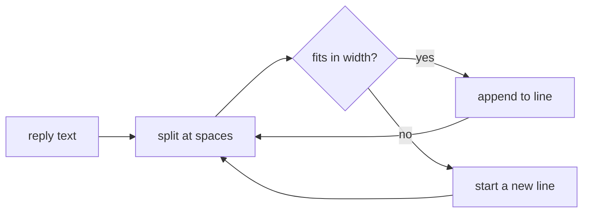

It is linear in the length of the reply. `wrap` visits each word once, but it measures the current line again for every word, so the cost of one call is

$$
T(n) = \sum_{i=1}^{w} \left(|\ell_i| + |v_i|\right) \le n \cdot \left(1 + \frac{W}{\bar{v}}\right)
$$

where $n$ is the reply's length in characters, $w$ the number of words $v_i$, $\ell_i$ the line being built when word $i$ arrives, $W$ the width, and $\bar{v}$ the mean word length. At $W = 72$ and English text ($\bar{v} \approx 5$) that is about $15n$: still linear, with a constant worth removing.

| Reply | Words | Today | Running width |
| :--- | ---: | ---: | ---: |
| One sentence | 18 | 0.4 µs | 0.1 µs |
| A paragraph | 160 | 3.9 µs | 0.9 µs |
| A long answer | 2,400 | 61 µs | 13 µs |

Keeping a running width beside `line`, instead of measuring it again, makes each word cost only its own length, so $T(n) = O(n)$ with a constant near 1. Want me to make that change?
