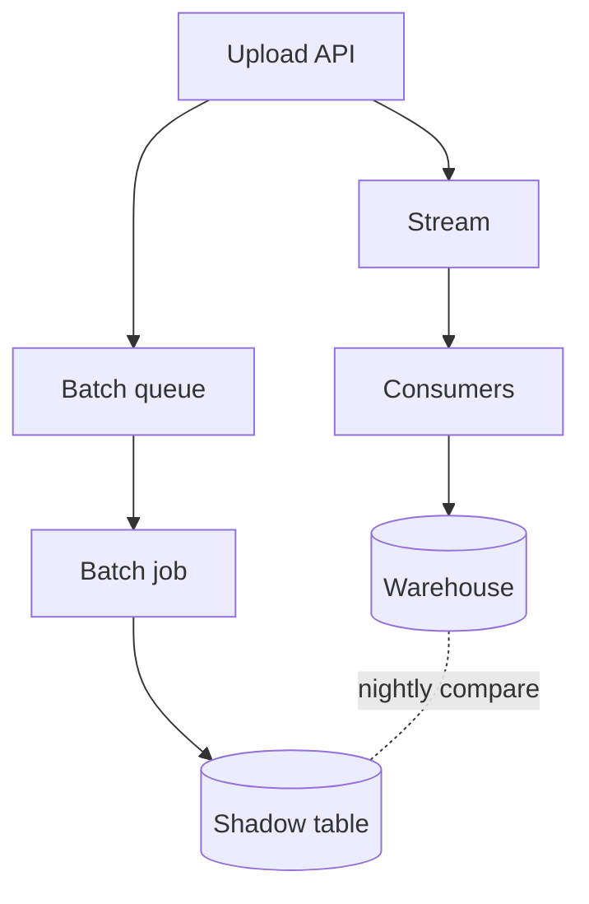

Here is the full migration plan for moving the ingest service from the batch queue to streaming. I kept the reasoning next to each step so you can challenge any of it, and linked the [design notes][notes] and the [queue contract][contract] where they matter.[^scope]

## Where we are

The ingest service reads uploads from the batch queue every five minutes, parses them, and writes rows into the warehouse. Three things make that painful today:

1. **Latency.** A file uploaded right after a batch starts waits up to ten minutes before anyone can query it.
2. **Retries.** A single malformed row fails the whole batch, and the retry replays every file in it.
3. **Cost.** The batch workers are sized for the peak, which is about eight times the median load.[^cost]

None of these is urgent on its own, but together they explain most of the pages the on-call rotation got last quarter.

> The batch design made sense when uploads were a few per hour.
It stopped making sense around the time the mobile app shipped,
and we never went back to it.

### What stays the same

- The warehouse schema, including the `ingested_at` column the dashboards read.
- The upload API and its authentication.
- The parsers themselves: `csv`, `jsonl` and `parquet` keep their current code paths.

## The plan

The migration runs in four stages, each behind a flag and each reversible within a day.

### Stage 1: dual write

Every upload goes to the batch queue as today **and** to a new stream partitioned by tenant. Nothing reads the stream yet.

```rust
pub async fn accept(upload: Upload, queues: &Queues) -> Result<Receipt, AcceptError> {
    let receipt = queues.batch.enqueue(&upload).await?;
    if flags::enabled("ingest.dual_write") {
        // Best effort: the batch path is still the source of truth.
        if let Err(error) = queues.stream.publish(upload.tenant, &upload).await {
            metrics::increment("ingest.stream.publish_failed");
            tracing::warn!(%error, tenant = %upload.tenant, "stream publish failed");
        }
    }
    Ok(receipt)
}
```

The publish failure is logged and counted but never fails the request. We want a week of data on the failure rate before anything depends on the stream.

### Stage 2: shadow consumers

A consumer per partition reads the stream, parses each file, and writes to a *shadow* table with the same schema. A nightly job compares the shadow table with the real one:

| Check | Query | Threshold |
| :--- | :--- | ---: |
| Row counts per tenant | `count(*)` grouped by tenant | 0 |
| Checksums per file | `sum(hash(row))` grouped by file | 0 |
| Late rows | rows with `ingested_at` more than 60 s after upload | 0.1 % |
| Duplicates | rows sharing a natural key | 0 |

Any non-zero difference in the first two checks pages the migration owner, not the on-call engineer.

<details>
<summary>Why a shadow table instead of comparing in memory</summary>

We considered having the consumer compare its output with the batch output as it goes. That fails for three reasons:

- The batch job and the consumer see files in a different order, so the comparison would need to buffer an unbounded amount of state.
- A mismatch found in memory is hard to investigate after the fact; a mismatch in a table can be queried, joined and shared.
- The shadow table doubles as the load test for Stage 3: it receives exactly the write pattern the real table will.

The cost is storage. At current volumes the shadow table grows by about 40 GB a week, and we drop it at the end of Stage 3. The nightly comparison takes around twelve minutes on the warehouse's small cluster, which is idle at that hour anyway.

One subtlety is the `ingested_at` column. The batch path stamps it when the batch *starts*, the stream path when the row is *written*, so the two never match exactly. The comparison ignores that column and checks lateness separately, against the upload time.

```sql
select tenant, count(*) as rows, sum(xxhash64(payload)) as checksum
from shadow.uploads
where upload_date = current_date - 1
group by tenant
except
select tenant, count(*), sum(xxhash64(payload))
from warehouse.uploads
where upload_date = current_date - 1
group by tenant;
```

</details>

### Stage 3: switch reads

Once the shadow table has matched for fourteen consecutive nights, the consumers write to the real table and the batch job writes to the shadow one. The comparison keeps running in the other direction. This is the step that actually changes what users see, so it goes tenant by tenant, starting with our own internal tenants.



### Stage 4: retire the batch path

When every tenant has been on the stream for a month without a rollback, we stop writing to the batch queue, delete the batch job and drop the shadow table.

## Capacity

The consumers scale with the number of partitions, and a partition's throughput is bounded by its slowest file. If $r$ is the median upload rate per tenant and $p$ the number of partitions, the expected queueing delay stays under a second while

$$
\rho = \frac{r \cdot \bar{s}}{p \cdot \mu} < 0.7
$$

where $\bar{s}$ is the mean file size and $\mu$ the parse rate of one consumer. With today's numbers that gives $\rho \approx 0.31$ at 32 partitions, so there is room to double the load before we need more.[^math]

## Risks

- [ ] **Ordering.** Two uploads of the same file name from one tenant must land in upload order. Partitioning by tenant keeps them in one partition, so this holds as long as a consumer processes a partition sequentially.
- [ ] **Poison files.** A file that crashes the parser would block its partition forever. The consumer moves a file to a dead-letter stream after three failed attempts and alerts.
- [x] **Backfill.** Historical data stays where it is; nothing here rewrites old rows.
- [ ] **Schema changes during the migration.** We freeze the upload schema from Stage 2 until Stage 4, which the product team has agreed to.

> [!WARNING]
> Rolling back Stage 3 for a tenant means replaying its uploads through the batch path. Budget an hour per large tenant, and do not roll back more than five tenants at once.

---

## Timeline

1. Stage 1 ships next week and runs for a week.
2. Stage 2 starts the week after and runs until fourteen clean nights, probably three weeks.
3. Stage 3 takes about a month, tenant by tenant.
4. Stage 4 is a day of work a month after the last tenant moves.

That puts the batch path's retirement roughly ten weeks out, which fits before the capacity review in the spring. If you want, I can turn each stage into tickets with owners and exit criteria, or draft the announcement for the tenants that move first.

[notes]: https://wiki.example.com/ingest/streaming-design "Streaming design notes"
[contract]: https://wiki.example.com/ingest/queue-contract

[^scope]: This covers the ingest service only; the export service keeps its batch schedule for now.
[^cost]: Measured over the last ninety days of worker utilisation.
[^math]: A back-of-the-envelope M/M/1 estimate; real traffic is burstier, which is why the threshold is 0.7 and not 0.9.
